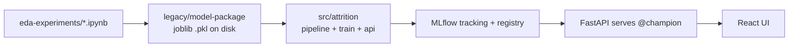

# From notebook to service

## What changed and why

1. **Dependencies:** the old Pipfile and `requirements.txt` pinned 2021-era versions (pandas 1.3, scikit-learn 0.24, pydantic 1.8), and the Pipfile listed the deprecated `sklearn` package. Everything now lives in one `pyproject.toml` with a committed `uv.lock`, so CI and Docker install exactly the same versions (`uv sync --frozen`).
2. **Data:** the notebooks read a local `attrition.csv` that was never committed. The trainer now downloads the same public Kaggle HR dataset from a URL (set with `DATA_URL`) and maps `left` → `attrition` and `sales` → `dept`.
3. **Model persistence:** `save_pipeline` wrote a versioned `.pkl` into the package and deleted older ones. MLflow replaces that. Every run is kept with its parameters and metrics, models are versioned in a registry, and an alias (`@champion`) decides what gets served. Promoting or rolling back means moving the alias. No rebuild needed.
4. **Validation:** the old pydantic schema had the wrong types (for example `dept: float` and `last_evaluation: str`) and was effectively bypassed. The API now validates ranges and allowed category values, and returns 422 for bad input.
5. **Model selection:** the trainer compares several C values and promotes the best by ROC AUC. The original C = 0.0005 had decent AUC but very low recall at the 0.5 threshold.
6. **Serving:** FastAPI loads the model once and returns a probability, a boolean and a risk band for each employee. It returns 503 until a champion exists.
7. **Testing:** offline tests use synthetic data and a stubbed model loader, so CI doesn't need the MLflow server or the internet.

## Going further (not needed locally)
- Move the MLflow backend to Postgres and the artifacts to S3, GCS or ADLS.
- Use a threshold tuned to the business cost of a missed leaver, instead of 0.5. Add calibration.
- Gate promotion to `@champion` on an evaluation check (for example, AUC no worse than the current champion).
- Try gradient-boosted models and log SHAP explanations as run artifacts.
- Schedule retraining, and monitor input drift on the API.
