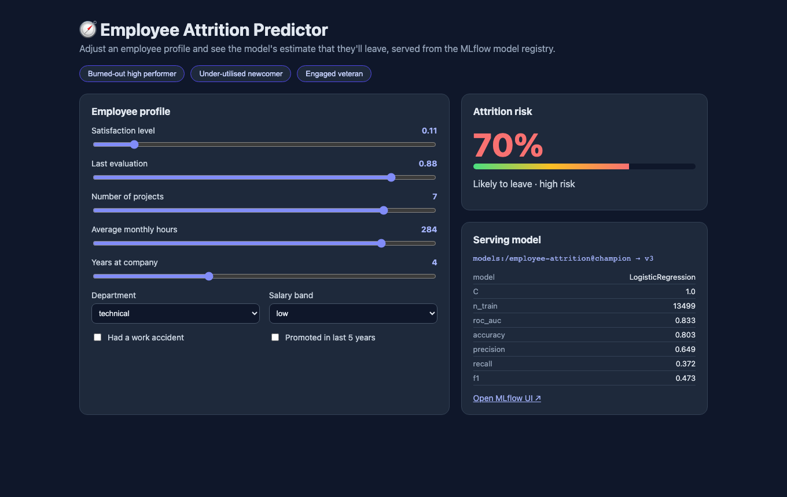
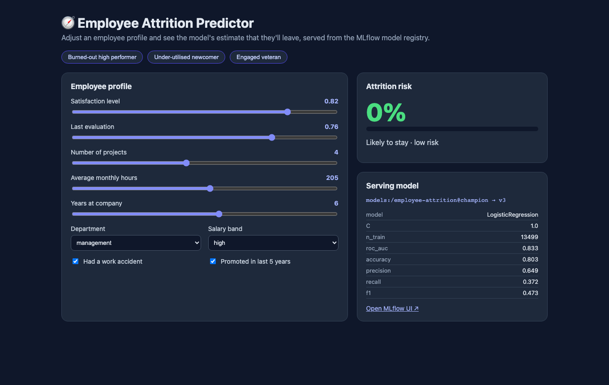
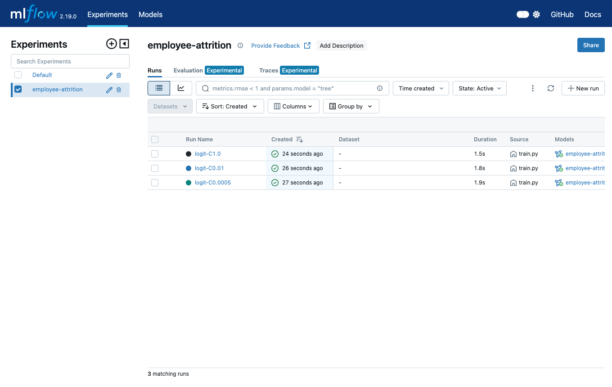
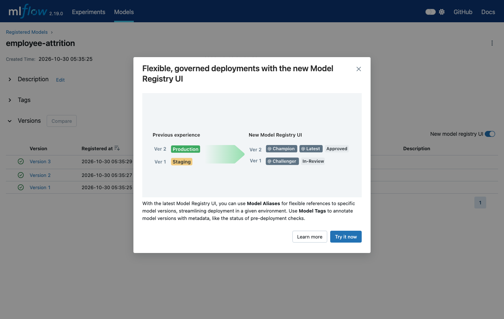
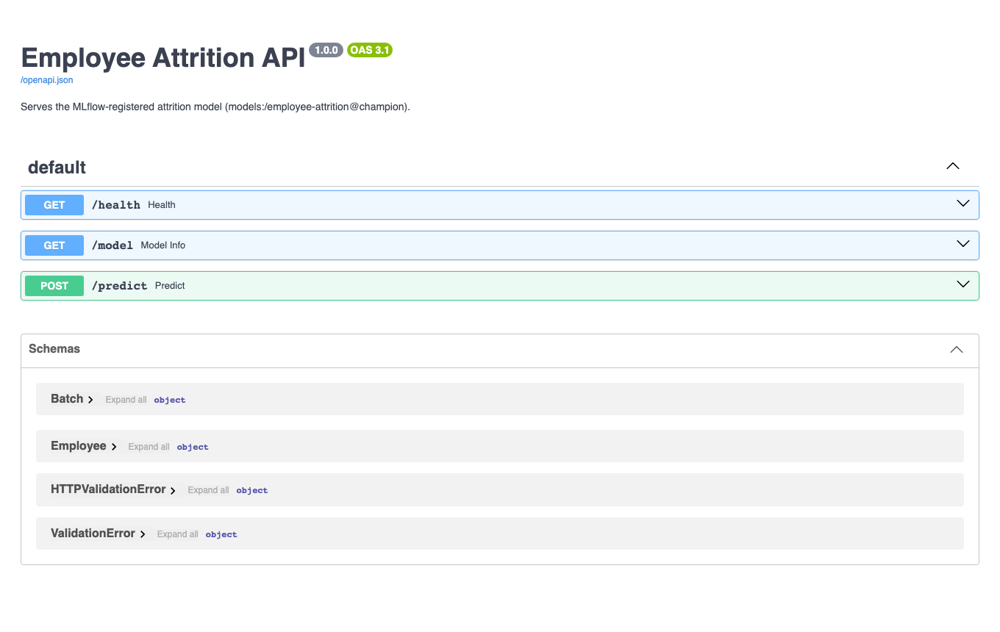
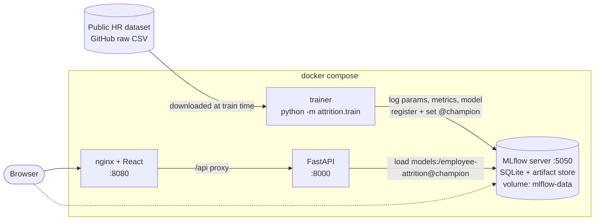
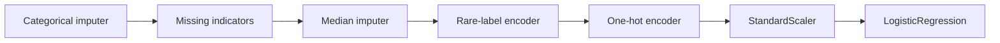

# 🧭 Employee Attrition Predictor

<p align="center"></p>

<p align="center"></p>

**Estimate how likely an employee is to leave, from satisfaction, workload, tenure and pay band. Training is tracked in MLflow, the model is served from the MLflow registry, and everything runs locally with one command.**

This began as an ML Zoomcamp (DataTalks.Club) mid-term project: notebooks plus a scikit-learn/feature-engine model package. It's now a full local stack: **uv** for Python dependencies, an **MLflow** tracking server and model registry, a **training job** that logs every run, a **FastAPI** service that loads the `@champion` model, and a **React** front end.



---

## Business case

Replacing an employee is expensive, and many departures could be prevented with an earlier conversation. This project estimates attrition risk from satisfaction, workload, tenure and pay band, with every training run tracked in MLflow and the served model pinned to a registry alias. It is a teaching model, and using it on real people needs strong privacy and fairness controls. [docs/BUSINESS_CASE.md](docs/BUSINESS_CASE.md) covers the sourced cost of turnover, use cases, an illustrative ROI model and the limits.

## Quick start

```bash
cp .env.example .env
docker compose up --build
```

| Service | URL |
|---|---|
| React app (nginx) | http://localhost:8080 |
| FastAPI (Swagger docs) | http://localhost:8000/docs |
| MLflow UI | http://localhost:5050 |

On startup, `trainer` downloads the public [Kaggle HR Analytics dataset](https://github.com/ryankarlos/Human-Resource-Analytics-Kaggle-Dataset) (15k employees). It trains three logistic-regression variants, logs them to MLflow, and tags the best one by ROC AUC as `employee-attrition@champion`. `api` starts once training has finished. No data or model files are stored in git.

> MLflow is on host port **5050**, because macOS AirPlay already uses 5000. Change `MLFLOW_PORT` in `.env` if you need to.

## The app

### 1. Build a profile and see the risk update live
Drag the sliders or pick a preset. The risk score, a red/amber/green meter and the verdict update as you change the inputs. The **Serving model** card shows which registry version is answering, plus its parameters and held-out metrics.



### 2. Compare training runs in MLflow
Every training run logs its parameters (C, training size, features), its metrics (ROC AUC, accuracy, precision, recall, F1), the model, its signature and an input example.



### 3. Model registry
Each run registers a version of `employee-attrition`, and the best one gets the `champion` alias. The API always serves `models:/employee-attrition@champion`.



### 4. Use the API directly

```bash
curl -X POST localhost:8000/predict -H 'content-type: application/json' -d '{"employees":[{
  "satisfaction_level":0.11,"last_evaluation":0.88,"number_project":7,"average_montly_hours":284,
  "time_spend_company":4,"Work_accident":0,"promotion_last_5years":0,"dept":"technical","salary":"low"}]}'
# {"model_version":"3","predictions":[{"attrition_probability":0.6956,"will_leave":true,"risk":"high"}]}
```



## Architecture

<p align="center"></p>



Startup order: `mlflow` (healthy) → `trainer` (exits 0) → `api` (healthy) → `web`.

## Model

The pipeline is the same one used in the notebook and `legacy/model-package`, built with feature-engine and scikit-learn:



Latest local run (10% stratified holdout): ROC AUC **0.833**, accuracy 0.803 with C = 1.0. The original C = 0.0005 scored a ROC AUC of 0.826 but only 0.13 recall, which is why the trainer now compares several values.

## Repo layout

| Path | What it is |
|---|---|
| `src/attrition/` | Config, pipeline, MLflow training script and FastAPI app |
| `web/` | React + Vite + TypeScript front end, built and served by nginx |
| `tests/` | Pipeline and API tests (offline, with synthetic data) |
| `pyproject.toml`, `uv.lock` | uv-managed dependencies |
| `scripts/screenshots.py` | Regenerates `docs/screenshots/` |
| `eda-experiments/` | Original EDA and pipeline notebooks |
| `legacy/` | The original `model-package`, Pipfile and editor settings (moved, not deleted) |

## Development

```bash
uv sync && uv run pytest -q
MLFLOW_TRACKING_URI=http://localhost:5050 uv run python -m attrition.train --C 0.01 0.1 1
MLFLOW_TRACKING_URI=http://localhost:5050 uv run uvicorn attrition.api:app --reload
cd web && npm install && npm run dev
```

CI (GitHub Actions) runs `uv sync --frozen` and `pytest`, then `docker compose build`. To start from an empty registry, run `docker compose down -v`.
